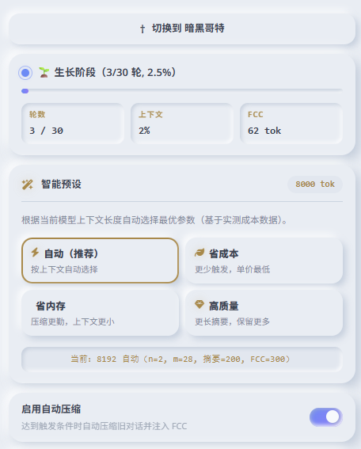
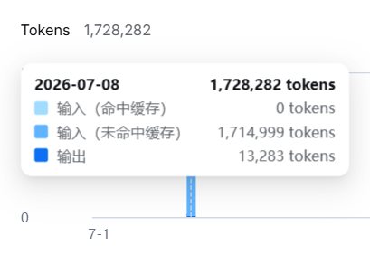

[English](README.md) | [简体中文](README.zh-CN.md)

# TokenSavingPlugin

> SillyTavern 专属 · n+m 分段生长策略上下文压缩插件  
> 极致缓存命中优化 · 自动滑动窗口 · 智能参数预设

**标签**：`<酒馆>` `<sillytavern>` `<插件>` `<缓存命中>` `<角色扮演>` `<上下文>` `<提示词>` `<缓存机制>` `<酒馆插件>` `<省钱>` `<API>` `<LLM>` `<总结>` `<摘要>` `<Token>` `<大肥鱼>`

---

## 目录

- [项目简介](#项目简介)
- [为什么需要 TokenSavingPlugin？](#为什么需要-tokensavingplugin)
- [解决方案](#解决方案)
- [缓存命中实测效果](#缓存命中实测效果)
- [核心特性](#核心特性)
- [安装](#安装)
- [快速开始](#快速开始)
- [实测成本数据](#实测成本数据)
- [工作原理](#工作原理)
- [常见问题](#常见问题)
- [更新日志](#更新日志)
- [作者](#作者)
- [许可证](#许可证)

---

## 项目简介

TokenSavingPlugin 是一款面向 SillyTavern 的上下文压缩与缓存命中优化插件，可将原本约 50% 的缓存命中率提升至 90% 甚至 94%。

依托 **n+m 分段生长策略**，当对话长度超出阈值时，插件会自动将久远的对话内容压缩为摘要，并追加至 **FCC（冻结压缩典籍）** 块。在完整保留对话叙事连贯性的前提下，大幅降低 Token 消耗。

---

## 把缓存命中率从 45% 拉到 90%+

如果你在 SillyTavern 中进行长对话，API 账单往往会因缓存命中率过低而快速上升。默认场景下，缓存命中率通常只有 **45%～55%**，每月 API 开销可能达到 **30 元甚至更多**。

TokenSavingPlugin 可以将缓存命中率从 **45% 提升到至少 90%**，避免因余额不足被 API 拒绝，也不再频繁看到：

> 余额不足，请登录平台查看余额信息。

**典型使用流程如下：**

1. 打开 SillyTavern，安装 `TokenSavingPlugin`。
2. 在酒馆的响应配置中，将上下文长度设为 `8192` 或更高。
3. 点击插件面板的「自动」，插件会自动填入推荐参数，无需手动计算。
4. 正常进行上百次甚至上千次对话。
5. 长对话场景下，账单可从原本每月约 **30 元**，降至 **10 元甚至更低**。

在改善聊天体验的同时，显著降低 API 开销。



---

## 为什么需要 TokenSavingPlugin？

长对话场景下，SillyTavern 默认机制通常会遇到以下痛点：

- **Token 爆炸**：对话累积几十轮后，历史记录会快速占满上下文窗口。
- **截断失忆**：原生逻辑直接丢弃最早的消息，造成角色记忆丢失。
- **费用失控**：每一轮请求都携带完整对话历史，API 开销线性上涨。
- **缓存失效**：对话上下文持续变动，API 缓存前缀频繁失效，无法复用缓存。

---

## 解决方案

| 痛点 | 解决方案 |
| :--- | :--- |
| Token 爆炸 | 将滑出窗口的历史对话压缩为摘要，压缩比最高可达 80%+ |
| 截断丢记忆 | 摘要提取关键剧情、人物关系与情绪，AI 可长期保留记忆 |
| API 费用高 | 构建稳定前缀，充分利用 API 缓存，单次调用成本降低 30%～50% |
| 缓存命中差 | FCC 块仅追加、永不修改，形成固定稳定前缀，持续命中缓存 |


### 账单爆炸与缓存未命中

当你在酒馆中调用 API 进行长对话时，是否遇到过账单突然飙升？是否在切换时区、尝试优化后，仍然发现大量提示词全部未命中缓存？

如下图所示：



使用本插件后，缓存命中与成本表现将得到显著改善。

---

## 缓存命中实测效果

原生酒馆的动态上下文会不断裁剪历史。一旦旧消息被截断，缓存前缀便会直接断裂，后续内容无法复用缓存。

本插件将溢出窗口的历史压缩为 200～300 Token 的摘要，并前置注入对话。持续追加的稳定前缀可以稳定命中 API 缓存。

> 以下为线上真实时段缓存命中率统计：

| 时段 | 命中输入 | 未命中输入 | 输出 | 总输入 | 命中率 |
| ---- | -------: | --------: | ---: | -----: | -----: |
| 22:00~23:00 | 568,957 | 109,999 | – | 678,956 | 83.80% |
| 23:00~24:00 | 305,663 | 43,012 | 13,438 | 348,675 | 87.67% |
| 00:00~01:00 | 280,191 | 26,568 | 5,960 | 306,759 | 91.34% |
| 00:00~01:00 | 335,743 | 29,831 | 6,932 | 365,574 | 91.84% |
| 00:00~01:00 | 1,110,143 | 77,190 | 20,631 | 1,187,333 | 93.50% |
| 01:00~02:00 | 524,288 | 56,079 | 13,719 | 580,367 | 90.34% |
| 02:00~03:00 | 7,282,680 | 387,842 | 161,945 | 7,670,522 | 94.94% |

---

## 核心特性

- **n+m 分段生长策略**：自研滑动窗口机制，自动管理对话历史，压缩行为稳定可控。
- **冻结压缩典籍（FCC）**：摘要仅追加、不修改已有内容，最大化 API 前缀缓存命中率。
- **智能预设**：根据模型上下文窗口大小自动推荐最优参数，基于大量实测成本数据。
- **三重防爆保护**：Prompt 长度校验 + 底层代码硬截断 + FCC 预算折叠多层兜底。
- **单块优先压缩**：整段历史尽量在 1 次 API 调用内压完（单块上限 49152 token），大幅减少压缩产生的调用次数。
- **API 熔断保护**：识别余额不足 / 密钥无效 / 无权限等致命错误后立即中止整轮压缩，并暂停自动压缩 5 分钟，避免反复报错烧钱。
- **压缩锁定机制**：压缩过程锁定输入框，避免并发消息冲突；支持手动终止压缩任务。
- **原生极简 UI**：沿用 SillyTavern 主题变量，自动适配暗色/亮色主题。

---

## 安装

### 方式一：Git 安装（推荐）

打开 SillyTavern 扩展面板，粘贴仓库地址：

```text
https://github.com/cloudfox-open/TokenSavingPlugin
```

点击 `Install Extension` 完成安装。

### 方式二：手动安装

1. 下载本仓库源码。
2. 将文件夹重命名为 `TokenSavingPlugin`。
3. 放入目录：`SillyTavern/public/scripts/extensions/third-party/`。
4. 浏览器刷新页面（F5）。

> **提示**：手动安装模式下，自动更新会提示 `not a Git repository`，该报错不影响插件全部功能。Git 安装方式无此提示。

---

## 快速开始

1. 加载角色卡，正常开启对话。
2. 打开扩展面板，找到 `TokenSavingPlugin`。
3. 在「智能预设」中点击 **自动**，插件会根据上下文自动配置参数。
4. 正常聊天，当对话达到阈值后会自动触发压缩，状态卡片实时展示进度。
5. 如果需要立即压缩，点击 **立即压缩** 手动触发。

### 参数详解

| 参数 | 说明 | 默认值 | 推荐范围 |
| ---- | :--- | -----: | :------ |
| 启用自动压缩 | 插件总开关 | 开启 | — |
| n（保留原文轮数） | 永久保留最近 n 轮对话原文，不参与压缩 | 5 | 3~6 |
| m（滑动窗口增量） | 可见轮数超过 `n+m` 时触发压缩。**自动计算**，输入框只读 | 自动 | — |
| **窗口填充目标** | 自动计算 m 时，把「可用上下文 − 前缀」这段聊天窗口填到该比例即触发压缩。**可调**，改动后转为「自定义配置」，点「自动」预设恢复 88% | **88%** | 85~90% |
| 单次摘要上限 | 单次压缩产出摘要的最大 Token 数量 | 210 | 150~400 |
| FCC 总预算 | FCC 块最大 Token 上限，超出后触发折叠 | 525 | 400~2000 |
| 分块大小 | 单次压缩请求携带的文本块大小，由「压缩发送上限」自动推算 | 自动 | — |
| 压缩发送上限 | 压缩期间临时放宽的上下文上限，压缩完恢复 | 64000 | 32000~128000 |
| 最大 API 调用次数 | 单次压缩最多调用几次 AI（内容大时自动提升，硬上限 30） | 4 | 3~8 |
| 前缀占用 | 世界书 + 角色卡 + 系统提示词等恒定内容的 token，**自动测量、只读** | 自动 | — |

> 原有的「Token 兜底阈值」已移除：自适应 m 已按 token 量分配窗口，再叠加百分比兜底会与之冲突。

### m 值：自动计算（不再固定）

自 v1.0.3 起，**m 不再由档位写死**，而是按当前聊天实际的消息量自动分配：

```
窗口预算 = 可用上下文（SillyTavern 已扣输出预留）− 前缀
目标     = 窗口预算 × 窗口填充目标（默认 88%）
m        = floor( 目标 ÷ 平均每轮 token ) − n
```

- **平均每轮 token** 取最近 **30 轮**（= 60 条消息）的均值；1 轮 = 用户 1 条 + AI 1 条。
- 因此剧情变长时 m 自动变小、变短时自动变大，触发点始终落在期望的 token 占比上。
- 面板「窗口策略」中 m 输入框为**只读**，下方给出完整算式（含均值样本范围）；手动修改即转为「自定义配置」。

以 8k 上下文、前缀 2881 tok 为例：

| 窗口填充目标 | 目标 tok | m | 窗口上限 | 触发时总占用 |
| ----: | ----: | ----: | ----: | ----: |
| 85% | 3862 | 50 | 55 轮 | 90% |
| **88%（默认）** | **3998** | **52** | **57 轮** | **92%** |
| 90% | 4089 | 54 | 59 轮 | 94%（实测会刚好挤出上下文） |

不同平均消息量下的实测推算（ST 上下文 8192 为例）：

| 平均单条 | 约合汉字 | 自动算出 m | 触发轮数 | 窗口占上下文 |
| ---- | ----: | -------: | -------: | -------: |
| 50 tok | ~75 字 | 55 | 61 | 74% |
| 100 tok | ~150 字 | 25 | 31 | 76% |
| 150 tok | ~225 字 | 15 | 21 | 77% |
| 240 tok | ~360 字 | 7 | 13 | 76% |

### 智能预设面板

面板内置 1 套一键预设，点击即可按当前模型上下文档位套用最优参数：

| 预设 | 适用场景 | 特点 |
| ---- | :--- | :--- |
| 自动 | 默认推荐（唯一预设） | 根据模型上下文长度自动选择 n / m / 摘要上限 / FCC 预算 / 分块大小 |

> 手动修改任意参数后，插件自动切换为「自定义配置」，预设按钮取消选中。
> 上下文档位发生变化（如换用更大上下文的模型）时，「自动」预设会重新套用对应档位的参数。

---

## 实测成本数据

> 数据基于 DeepSeek API 真实压测。

| 上下文 | m 值 | 调用次数 | 总花费（元） | 单价（元/次） | 结论 |
| ---- | -------: | -------: | -------: | -------: | :--- |
| 4096 | 3 | 56 | 0.06 | 0.00107 | 压缩触发过于频繁 |
| 4096 | 12 | 118 | 0.10 | 0.00085 | 性能明显改善 |
| 8192 | 28 | 106 | 0.05 | 0.00047 | 最优甜点配置 |
| 8192 | 60 | 329 | 0.18 | 0.00055 | 单次压缩成本上升 |

**核心结论**：在 8192 上下文窗口场景下，单次请求成本约为 4096 的一半，得益于更长、更稳定的缓存前缀。m 已改为按实际消息量**自动计算**（目标填充上下文 85%），不再依赖固定的档位系数。

---

## 工作原理

### 数据流

1. AI 回复完成。
2. 计算当前可见对话轮数与 Token 占用比例。
3. 判断触发条件：窗口溢出（轮数 > `n+m`）**或** Token ≥ 阈值。
4. 临时放宽上下文至「压缩发送上限」，按待压内容大小自动申请。
5. 锁定输入框 + 隐藏待压缩消息。
6. 分块提交至 AI 进行压缩（优先整段一次压完，单块上限 49152 token）。
7. 追加摘要到 FCC + 持久化保存 + 注入 Prompt；超出 FCC 预算时折叠或硬截断。
8. 恢复上下文并解锁输入框。

---

## 常见问题

<details>
<summary><b>Q1: 为什么插件刚开始聊天不会触发压缩？</b></summary>

压缩需要满足**任一**条件才会启动：可见对话轮数超过 `n + m`；或者 Token 占比达到阈值（默认 80%）。对话前几轮属于“生长阶段”，正常继续聊天即可。

</details>

<details>
<summary><b>Q2: 压缩触发太频繁 / 很久都不压缩？</b></summary>

- **压缩过于频繁**：调低「窗口填充目标」（如 88% → 85%），让窗口装更多轮才触发。
- **压缩很久不触发**：调高「窗口填充目标」（如 88% → 90%），或检查前缀是否占用了过多上下文。

</details>

<details>
<summary><b>Q3: 压缩会不会丢失剧情记忆？</b></summary>

**不会**。插件提供三层安全保护：

1. 压缩调用失败或手动中止，自动恢复原始对话内容。
2. FCC 只追加写入，历史摘要永久保存。
3. 单块优先压缩：整段历史尽量一次压完，减少分块摘要之间的信息损耗。

最坏场景：压缩任务失败，对话保持原样，消息不会隐藏或丢失。

</details>

<details>
<summary><b>Q4: 支持哪些 API 服务商？</b></summary>

支持所有 SillyTavern 可对接的 API：DeepSeek / OpenAI / Claude / Gemini / 本地大模型等。

> 不支持 JSON Schema 的 API 会自动降级到普通压缩模式。

</details>

<details>
<summary><b>Q5: 压缩的时候输入框为什么变灰无法发送？</b></summary>

这是**保护机制**，用于防止压缩任务运行时用户发送消息，造成对话生成与压缩任务冲突。

如果需要中断压缩，可以点击红色 **停止压缩** 按钮，插件会恢复原始对话。压缩通常只需 1~2 秒，无需担心。

</details>

<details>
<summary><b>Q6: 会不会出现一堆 API 返回 UnprocessableEntity 错误？</b></summary>

不会。插件不依赖 OpenAI 新版 `response_format={"type":"json_schema", ...}` 结构化输出，压缩结果是按普通文本解析的（解析失败会自动逐字段兜底提取），因此在只兼容 `/chat/completions` 的服务商上也能正常工作。

</details>

<details>
<summary><b>Q7: 为什么安装的时候出现 SyntaxError: Expected ',' or '}' after property value in JSON at position 416 (line 14 column 33)？</b></summary>

这是因为插件代码原因，现已修复。

</details>

---

## 更新日志

完整更新记录详见 `CHANGELOG.md`。

### v1.0.3

- 移除 Feynman 质量自检，每次压缩固定减少 1 次 API 调用。
- 移除「Token 兜底阈值」：自适应 m 已按 token 量分配窗口，百分比兜底会与之冲突。
- 新增单块优先压缩：整段历史尽量 1 次 API 调用压完（单块上限 49152 token）。
- 新增「窗口填充目标」可调参数（默认 88%，随「自动」预设管理）。
- 自适应 m：按最近 30 轮均值分配窗口，并扣除前缀（世界书 + 角色卡 + 系统提示词）。
- 修复压缩上下文放宽未生效、以及窗口预算重复扣除输出预留的问题。

### v1.0.2

- 压缩期间锁定输入框和发送按钮。
- 新增「停止压缩」按钮，支持随时中断任务。

---

## 作者

cloudfox-open

- GitHub：[@cloudfox-open](https://github.com/cloudfox-open)
- 项目主页：[TokenSavingPlugin](https://github.com/cloudfox-open/TokenSavingPlugin)

---

## 许可证

MIT License

---

<div align="center">

如果这个项目对你有帮助，欢迎点亮 Star ⭐

Made with ❤️ by cloudfox-open

</div>
